<div align="center">

<picture>
  <source media="(prefers-color-scheme: dark)" srcset=".github/assets/banner-dark.svg">
  
</picture>

**Drive Chrome and Chromium from typed PHP, straight over the DevTools Protocol.**<br>
PAM supervises the browser process and speaks CDP over its own WebSocket transport. Node.js, npm, Puppeteer and Playwright are never installed.

[](https://packagist.org/packages/pushinbr/pam-browser)
[](https://github.com/push-in/pam-browser/releases/latest)

[](LICENSE)

[Install](#install) · [Quick example](#quick-example) · [What it covers](#what-it-covers) · [Docs](#docs) · [Issues](https://github.com/push-in/pam-browser/issues)

</div>

<a id="install"></a>
## <picture></picture> Install

Create a PAM project and add the browser client:

```sh
pam init my-app --template raw
cd my-app
pam composer require pushinbr/pam-browser
```

Install Chrome or Chromium separately on the host. PAM Browser supervises that external process and speaks CDP directly; no Node.js or browser-automation wrapper is installed. New to PAM? Start with the [PAM introduction](https://push-in.github.io/pam-docs/introduction/).

<a id="quick-example"></a>
## <picture></picture> Quick example

Launch Chromium, evaluate JavaScript in a page and receive data back in PHP through a binding. Save it as `browser.php` and run `pam browser.php`.

```php
<?php

declare(strict_types=1);

require __DIR__.'/vendor/autoload.php';

use Pam\Browser\Browser;

$browser = Browser::launch();
try {
    $product = $browser->version()['product'] ?? 'unknown';

    $page = $browser->newPage('data:text/html,<title>PAM Browser</title>');
    echo $page->evaluate('document.title'), "\n"; // PAM Browser

    $page->exposeBinding('fromPage', static function (mixed $payload): void {
        var_dump($payload); // ['bridge' => 'ready']
    });
    $page->evaluate('globalThis.fromPage(JSON.stringify({bridge: "ready"}))');
    $page->pump(1.0);

    printf("Connected to %s, target %s\n", $product, $page->targetId);
} finally {
    $browser->close();
}
```

Adapted from [`tests/integration/chromium.php`](tests/integration/chromium.php), the live Chromium gate. `Browser::launch()` accepts `Pam\Browser\Chromium\LaunchOptions` (executable, user data directory for a persistent profile, headless, timeout, extra arguments).

<a id="platform-support"></a>
## <picture></picture> Platform support

| Platform | Support | Notes |
| --- | --- | --- |
| PAM runtime host | Chrome or Chromium installed | Found on `PATH` (`google-chrome-stable`, `google-chrome`, `chromium`, `chromium-browser`, `chrome`), or set `PAM_CHROME_PATH` / `LaunchOptions::executable` |
| PHP | 8.5+ | From `composer.json` |

<a id="what-it-covers"></a>
## <picture></picture> What it covers

| Layer | Classes |
| --- | --- |
| Protocol codec and event routing | `Protocol\Command`, `Protocol\Response`, `Protocol\Event`, `Connection` (`command`, `on`, `waitForEvent`, `pump`) |
| PAM-native WebSocket transport | `Transport\WebSocketTransport`, `WebSocket\FrameCodec` (no third-party WebSocket dependency) |
| Supervised Chrome/Chromium lifecycle | `Chromium\BrowserProcess`, `Chromium\LaunchOptions`, `Chromium\ExecutableLocator`, persistent profiles |
| Browser and pages | `Browser` (`launch`, `version`, `newPage`, `createTarget`, `close`), `Page` (`navigate`, `evaluate`, `waitForFunction`, `exposeBinding`, `addScriptOnNewDocument`, `captureScreenshot`, `setUserAgent`, `authenticate`, `serveDocument`, `captureDocument`) |

The browser itself remains an external Chrome/Chromium process. JavaScript may be evaluated inside a page, while the application API and orchestration remain strictly typed PHP. PAM Browser is the browser boundary used by [PAM WhatsApp Web](https://github.com/push-in/pam-whatsapp-web).

<a id="verification"></a>
## <picture></picture> Verification

```sh
pam composer analyse           # PHPStan level 9
pam composer test              # PHPUnit
pam composer test:integration  # live Chromium gate: pam tests/integration/chromium.php
```

<a id="docs"></a>
## <picture></picture> Docs

- [PAM introduction](https://push-in.github.io/pam-docs/introduction/)
- [Packages overview](https://push-in.github.io/pam-docs/packages/overview/)
- [Changelog](CHANGELOG.md)
- [Report an issue](https://github.com/push-in/pam-browser/issues)

<a id="pam-ecosystem"></a>
## <picture></picture> Part of the PAM ecosystem

<p align="center"><picture>
  <source media="(prefers-color-scheme: dark)" srcset=".github/assets/pam-wordmark-dark.svg">
  
</picture></p>

PAM runs PHP natively on servers, desktops and phones. This repository is one piece of it.

| [**PAM**](https://github.com/push-in/pam) | [**PAM Desktop**](https://github.com/push-in/pam-desktop) | [**PAM Native**](https://github.com/push-in/pam-native) | [**Ecosystem**](https://github.com/push-in/pam#ecosystem) |
| --- | --- | --- | --- |
| the runtime and CLI | native desktop apps in PHP | native Android and iOS apps in PHP | every official package and plugin |

<sub>Docs: [push-in.github.io/pam-docs](https://push-in.github.io/pam-docs/introduction/) · [Issues](https://github.com/push-in/pam-browser/issues)</sub>

<p align="center"><sub><a href="LICENSE">Apache License 2.0</a> · Made in Brazil by Pushin</sub></p>
